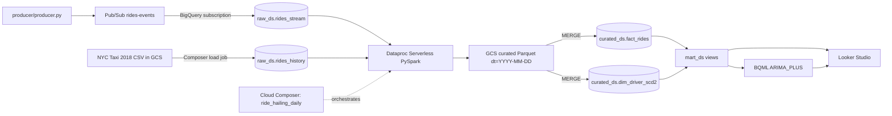

# Ride-Hailing Analytics Platform

Daily ride-hailing analytics on GCP: operational metrics, 7-day demand forecast, SCD Type 2 driver dimension and data-quality gates.

## Architecture



Live messages go from Pub/Sub straight into BigQuery through a **BigQuery subscription**. Dataflow is intentionally not used (its job failed on every run). The JSON payload is stored in `raw_ds.rides_stream.data` and `publish_time` is used as `ingest_ts`; Spark parses it.
`docs/architecture.png` still shows the Dataflow box and needs to be re-exported without it.

## Repository layout

| Path | Purpose |
| --- | --- |
| `producer/` | Mock Pub/Sub producer (1000 events / 10 min) |
| `spark/` | PySpark job `process_rides.py` + unit tests |
| `sql/` | DDL, MERGEs (fact, SCD2), mart + cost views, BQML |
| `dags/` | Composer DAG `ride_hailing_daily` + tests |
| `bootstrap.sh` | Creates bucket, datasets, topic/subscription, data, secret, budgets, Composer |
| `docs/` | Design doc and architecture diagram |

Detailed demo handbook: `docs/demo_documentation.md`.

## Run

Run in Cloud Shell (or any shell with `gcloud`/`bq` authenticated to the project):

```bash
export PROJECT_ID=labs-507309 ALERT_EMAIL=you@example.com
./bootstrap.sh infra      # bucket (+14-day raw/ lifecycle), datasets, tables, Pub/Sub->BQ subscription,
                          # NYC taxi 2018 sample, zones, driver snapshots, secret, budget alerts
./bootstrap.sh composer   # smallest Composer 3 env with Secret Manager backend (~25 min)
./bootstrap.sh deploy     # uploads DAG, sql/ and spark/ code
```

If `raw_ds.rides_stream` already exists from the earlier consumer approach, drop it first (`bq rm -t PROJECT:raw_ds.rides_stream`); the script stops with this hint.

Publish live data (stamped with yesterday's date so the daily run picks it up):

```bash
pip install -r producer/requirements.txt
python producer/producer.py --project $PROJECT_ID
```

Trigger the DAG from the Composer UI, or backfill the last 7 days on demand:

```bash
gcloud composer environments run ride-hailing --location us-central1 dags backfill -- \
  -s $(date -u -d '-7 day' +%F) -e $(date -u -d '-1 day' +%F) ride_hailing_daily
```

Tests: `pip install pytest pyspark apache-airflow apache-airflow-providers-google` then `pytest spark/tests dags/tests`.

## DAG `ride_hailing_daily` (02:00 UTC, SLA 4 h)

`sense_historical_dump` → `load_history_to_raw` → `run_curated_spark` → `merge_fact` → `merge_dim_scd2` → `refresh_mart_views` → weekly branch (`retrain_bqml` on Monday runs / `skip_retrain`) → `dq_checks` (metrics pushed to XCom) → `branch_on_dq` → `alert` or `notify_success`.

- 2 retries with exponential backoff, 4 h SLA and run timeout, `max_active_runs=1` (date-ordered runs for SCD2), `catchup=False` with on-demand backfill.
- Idempotent: history load is `WRITE_TRUNCATE`, Spark overwrites only the `dt` partitions it produces, fact/dim are `MERGE`s.
- DQ gate: rows for the run date, null ratio ≤ 1 %, no negative fares, no duplicate `ride_id`.
- Secrets: Composer uses the Secret Manager backend; `alert_email` is the secret `airflow-variables-alert_email`. Notifications are emailed when SendGrid/SMTP is configured in Composer; otherwise they are written to the task log.

## Data model

- Visual overview: [docs/data_model.png](docs/data_model.png). The curated layer is fact-centric and star-schema-like, but not a snowflake schema: zone labels are denormalized in the fact table. Driver history is SCD Type 2 and joined by `driver_id`.
- `curated_ds.fact_rides`: partition `pickup_date`, cluster `pickup_zone, driver_id`.
- `curated_ds.dim_driver_scd2`: tracks `address` and `vehicle_type`; the sample snapshots change some drivers 3 days ago.
- `mart_ds`: `v_daily_revenue`, `v_zone_demand_hourly`, `v_driver_leaderboard`, `zone_demand_forecast`, cost views `v_cost_daily_bytes`, `v_cost_top_queries`.
- BQML ARIMA_PLUS forecasts 168 hours for the top 10 zones. It trains on the 2018 history series, the only contiguous hourly series; live data covers a single recent day.

## Looker Studio

Create a report on `mart_ds`:
Link:https://datastudio.google.com/reporting/08647ee8-ee9f-4ac6-94ab-6ce345c095d5

Screenshot:


- KPI tiles from `v_daily_revenue` (yesterday): `trips`, `revenue`, `avg_surge`, `active_drivers`.
- Line chart: `revenue` by `pickup_date`, last 30 days.
- Heatmap: `v_zone_demand_hourly` (`pickup_zone_name` × hour of `hour_ts`, metric `trips`).
- Forecast overlay: `zone_demand_forecast`.
- Cost report: `v_cost_daily_bytes` and `v_cost_top_queries`.

## Cost controls and estimate

- Composer: smallest size (`small`), delete after the project: `gcloud composer environments delete ride-hailing --location us-central1`. This is the main cost, roughly a few USD per day.
- Dataproc Serverless batches only (no clusters), executors capped at 4; runs for a few minutes per day.
- Pub/Sub (1000 msgs) and the BigQuery subscription are within the free tier; no Dataflow workers.
- BigQuery: every job capped at `maximumBytesBilled` = 10 GB, tables are partitioned and clustered; data volume is a few MB, well inside the free 1 TB/month.
- GCS: `raw/` objects deleted after 14 days. Budget alerts at $50 and $100 are created by `bootstrap.sh`.

Expected total for the 3-day project: under $20, dominated by Composer.
