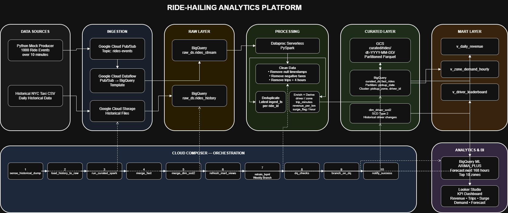
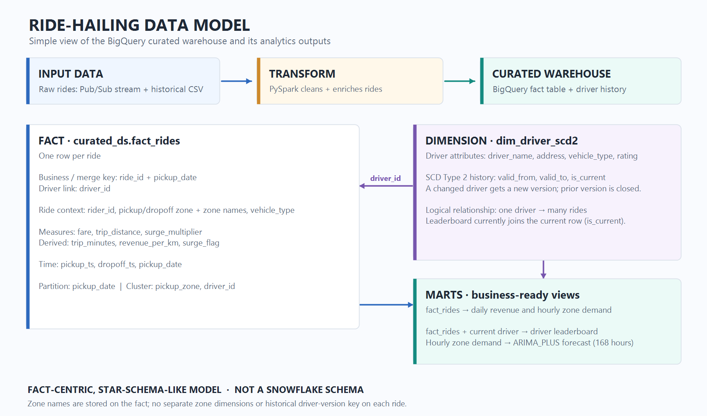
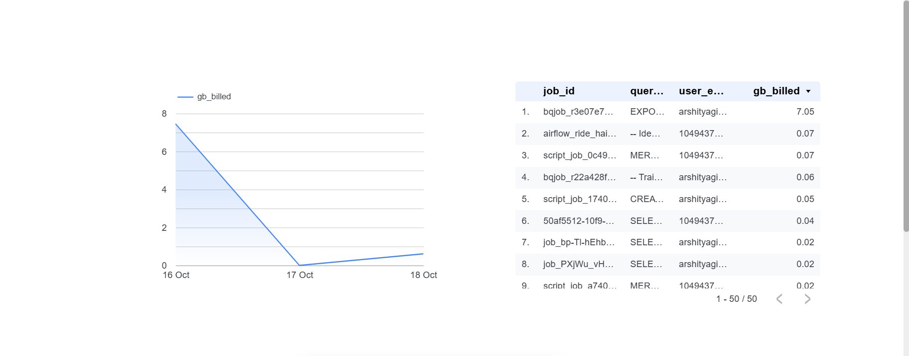

# Ride-Hailing Analytics Platform - Demo Documentation

## 1. Purpose of this document
This document is a complete demo guide for presenting the project to any audience.

It includes:
- what the project does,
- where each resource exists in GCP,
- the exact demo flow to follow,
- which SQL queries to run live,
- which screenshots to show in sequence,
- and what to say while presenting each step.

## 2. Project objective (simple explanation)
The project builds a daily analytics platform for a ride-hailing business.

It answers four business needs:
- operational KPIs by morning (trips, revenue, active drivers, surge),
- zone-level demand pattern,
- 7-day demand forecast,
- driver history tracking with SCD Type 2.

## 3. End-to-end architecture used in demo
Streaming path used in demo narration:
- Python Producer -> Pub/Sub -> Dataflow (Pub/Sub to BigQuery template) -> BigQuery Raw

Batch path:
- Historical CSV in GCS -> BigQuery Raw

Transformation path:
- BigQuery Raw -> Dataproc Serverless PySpark -> Curated Parquet in GCS -> BigQuery curated tables

Serving path:
- BigQuery curated -> mart views -> BQML forecast -> Looker Studio dashboard

Orchestration:
- Cloud Composer DAG `ride_hailing_daily`

Architecture image:



## 4. GCP resource map (where to show each component)
Use this section in the demo while opening the GCP Console.

| Layer | Resource | GCP location to open |
| --- | --- | --- |
| Project | `labs-507309` | Project selector |
| Pub/Sub topic | `rides-events` | Pub/Sub -> Topics |
| Dataflow job | Pub/Sub to BigQuery streaming job | Dataflow -> Jobs |
| Raw dataset | `raw_ds` | BigQuery -> Explorer |
| Raw stream table | `raw_ds.rides_stream` | BigQuery -> `raw_ds` |
| Raw history table | `raw_ds.rides_history` | BigQuery -> `raw_ds` |
| GCS bucket | `gs://labs-507309-ride-hailing` | Cloud Storage -> Buckets |
| Curated Parquet | `curated/rides/dt=...` | Bucket -> folders |
| Curated fact table | `curated_ds.fact_rides` | BigQuery -> `curated_ds` |
| SCD2 dimension | `curated_ds.dim_driver_scd2` | BigQuery -> `curated_ds` |
| Mart dataset | `mart_ds` | BigQuery -> Explorer |
| Forecast model | `mart_ds.zone_demand_arima` | BigQuery -> Models |
| Forecast table | `mart_ds.zone_demand_forecast` | BigQuery -> `mart_ds` |
| Composer environment | `ride-hailing` | Composer -> Environments |
| Secrets | `airflow-variables-alert_email` | Security -> Secret Manager |

## Data model (simple explanation)



The curated layer is a fact-centric, star-schema-like model, not a snowflake schema. `fact_rides` contains ride-level measures and zone labels, while `dim_driver_scd2` keeps driver attribute history. The driver leaderboard joins them by `driver_id` and selects the current driver row. Because zone labels are stored on the fact and no historical driver-version key is stored on each ride, this is not a strict, fully normalized star schema.

## 5. Demo flow (step by step with speaking notes)

### Step 1: Open architecture and explain the flow (1 minute)
What to show:
- architecture image,
- high-level path from ingestion to dashboard.

What to say:
- "Streaming rides are published to Pub/Sub and processed through Dataflow into BigQuery raw."
- "Historical files are loaded from GCS into BigQuery raw."
- "Dataproc Serverless transforms both sources into curated outputs."
- "Composer orchestrates daily execution, and Looker serves business metrics."

### Step 2: Show orchestration in Composer/Airflow (2 minutes)
What to show:
- DAG list screen,
- `ride_hailing_daily` graph,
- successful run status and task sequence.

What to say:
- "This DAG controls load, transform, merge, mart refresh, forecast retrain, and DQ checks."
- "Retries, SLA, and branching are configured for production-like behavior."

### Step 3: Show ingestion evidence (1 minute)
What to show:
- Pub/Sub topic,
- Dataflow job details (template, state, throughput),
- BigQuery `raw_ds.rides_stream` row count.

What to say:
- "The producer sends live events; Dataflow streams them to raw BigQuery."
- "This validates real-time ingestion is functioning."

### Step 4: Show storage and processing outputs (2 minutes)
What to show:
- GCS bucket folders (`historical/`, `raw/driver_snapshot/`, `curated/rides/`),
- curated fact and SCD2 tables.

What to say:
- "Curated Parquet is date-partitioned in GCS."
- "Fact and dimension are maintained in BigQuery via MERGE jobs."
- "SCD2 keeps driver history over time."

### Step 5: Run warehouse validation queries (2 minutes)
What to show:
- query results for source counts, daily KPI view, leaderboard, SCD2 records, forecast row count.

What to say:
- "We can see both stream and historical records in fact rides."
- "SCD2 shows current active records and historical changes."
- "Forecast table contains 168 hours for top 10 zones."

### Step 6: Show Looker dashboard and cost insights (2 minutes)
What to show:
- KPI tiles,
- daily trend,
- zone heatmap,
- forecast chart,
- cost report page.

What to say:
- "Dashboard provides operational metrics and forecast in one place."
- "Cost views help monitor BigQuery usage and expensive queries."

## 6. SQL queries to run in demo (and screenshot)
Run these in Cloud Shell.

```sql
-- Q1: fact coverage by source
SELECT source, COUNT(*) AS rides, MIN(pickup_date) AS first_day, MAX(pickup_date) AS last_day
FROM `labs-507309.curated_ds.fact_rides`
GROUP BY source;

-- Q2: daily KPI view
SELECT *
FROM `labs-507309.mart_ds.v_daily_revenue`
ORDER BY pickup_date DESC
LIMIT 5;

-- Q3: driver leaderboard
SELECT *
FROM `labs-507309.mart_ds.v_driver_leaderboard`
ORDER BY revenue_rank
LIMIT 5;

-- Q4: SCD2 verification for changed drivers
SELECT driver_id, vehicle_type, address, valid_from, valid_to, is_current
FROM `labs-507309.curated_ds.dim_driver_scd2`
WHERE driver_id IN ('D0010','D0015')
ORDER BY driver_id, valid_from;

-- Q5: forecast volume check (expected 1680 rows and 10 zones)
SELECT COUNT(*) AS rows_, COUNT(DISTINCT pickup_zone) AS zones
FROM `labs-507309.mart_ds.zone_demand_forecast`;
```

## 7. Screenshot plan (what to include in final document)
This is the exact screenshot sequence recommended for your demo deck/report.

1. Architecture diagram
- File: `docs/architecture.png`
- Caption: "Complete architecture for streaming, batch, processing, warehouse, and BI"

2. Composer environment page
- Suggested file: `docs/screenshots/01_composer_environment.png`
- Caption: "Composer environment used for orchestration"

3. Airflow DAG list
- Suggested file: `docs/screenshots/02_airflow_dag_list.png`
- Caption: "DAG availability and recent run status"

4. Airflow DAG graph with task states
- Suggested file: `docs/screenshots/03_airflow_dag_graph.png`
- Caption: "End-to-end orchestration with retries and branching"

5. Dataflow job details (important)
- Suggested file: `docs/screenshots/04_dataflow_streaming_job.png`
- Caption: "Pub/Sub to BigQuery streaming template job"

6. BigQuery query result evidence (Q1-Q5)
- Suggested file: `docs/screenshots/05_bq_query_results.png`
- Caption: "Fact volume, KPI view, SCD2 validation, forecast row checks"

7. Looker operations dashboard page
- Suggested file: `docs/screenshots/06_looker_operations_dashboard.png`
- Caption: "KPI tiles, trend, heatmap, forecast"

8. Looker cost report page
- File: `docs/screenshots/08_cost_report.png`
- Caption: "Daily bytes billed and top query cost contributors"

Included screenshot:



## 8. Dataflow screenshots still needed from your side
Please add these two screenshots from your previous Dataflow runs so the document fully reflects Dataflow ingestion:
- Dataflow Jobs list page showing the streaming job name and state.
- Dataflow Job detail page showing template, source topic, sink table, and throughput counters.

Save them with these exact names for auto-mapping:
- `docs/screenshots/04_dataflow_streaming_job.png`
- `docs/screenshots/04b_dataflow_job_metrics.png`

## 9. Demo close statement (use this at the end)
"This project demonstrates a complete GCP data engineering pipeline: streaming and batch ingestion, serverless processing, curated warehouse modeling, SCD2 history tracking, automated orchestration, forecast generation, data quality checks, and BI reporting with cost observability."

## 10. Final checklist before presenting
- [ ] Looker Studio report link is reachable by reviewers.
- [ ] Airflow screenshots are visible in documentation.
- [ ] Dataflow screenshots are added.
- [ ] Query output screenshot includes Q1 to Q5.
- [ ] Cost report screenshot is added.
- [ ] Architecture image matches narrated flow.
